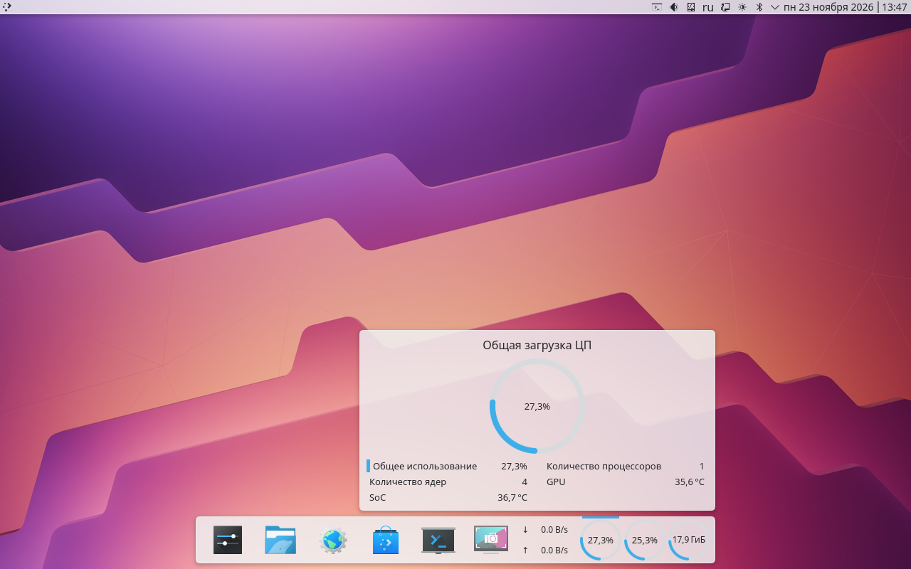

# YS-F66C: Plasma 6

[](https://jacobtey-sudo.github.io/armbian-ys-f66c-plasma6/slideshow.html "Слайд-шоу: ещё два снимка")

Desktop-слой и сборка образа **KDE Plasma 6** для планшета **Yisheng YS-F66C**
на SoC **Rockchip RK3566**.

Репозиторий — самодостаточная точка входа: `scripts/build.sh` клонирует
сборочный фреймворк Armbian и board-support на зафиксированных коммитах,
накладывает overlay этого репозитория и собирает готовый к записи образ.
Все зависимости публичные и закреплены в [`config/versions.env`](config/versions.env).

**English TL;DR:** Plasma 6 desktop layer and image build for the Yisheng
YS-F66C RK3566 tablet. `./scripts/build.sh` assembles the pinned Armbian build
framework, board support and this overlay, then produces a flashable image.
Documentation is in Russian.

## Что в образе

- **База:** Debian 13 `trixie`, KDE Plasma `6.3.6`, Qt `6.8.2`.
- **Ядро:** `6.1.172-vendor-rk35xx` (rockchip vendor, board-support).
- **Сессия:** Plasma 6 Wayland (KWin), вход через SDDM.
- **Экран:** 1280×800, поворот панели от загрузки: fbcon → SDDM → KWin.
- **Клавиатура:** Maliit OSK (ru/en) в Plasma, три размера клавиш,
  выбор размера из меню «Settings…».
- **Локаль и раскладки:** `ru_RU.UTF-8`, раскладки `ru,us`.
- **Панель:** Application Dashboard, Window Buttons, системные мониторы
  (CPU, RAM, диск, сеть), виджет «Использование EMMC».
- **Приложения:** Discover, Yakuake, Dolphin, Kate, Konsole, Firefox ESR,
  KDE Connect, Gwenview, System Monitor.
- **Звук:** RK817 (в составе RK809), динамик и 3.5 мм; проводные наушники
  глушат динамик. Bluetooth A2DP (SBC) + HFP для микрофона, автоподключение
  доверенных устройств.
- **Камера:** USB UVC, повёрнутая виртуальная камера `/dev/video10`.
- **Питание:** DPMS-выключение экрана отключено, swap на zram, кнопка
  питания открывает меню завершения работы.
- **Тихий интерфейс:** системный звонок KDE выключен и заблокирован,
  звук изменения громкости выключен; OSD громкости остаётся.
- **Стабильность Qt 6.8.2:** дисковый QML-кэш отключён (обход падения
  KWin/plasmashell/Discover).
- **FlClash** (arm64) ставится при сборке из зафиксированного релиза,
  SHA256 проверяется; `.deb` в git не хранится.
- Предсозданных пользователей нет: при первом запуске работает штатный
  first-run Armbian.

## Быстрый старт

Готовый образ — в [Releases](https://github.com/jacobtey-sudo/armbian-ys-f66c-plasma6/releases):
`.img.xz` 1,77 ГиБ, рядом `.sha256` и отчёт сборки. Это **pre-release**:
образ проверен, но полный smoke-тест после прошивки не проходил. Сборка из
исходников — ниже.

Требования к сборочной машине:

- Linux x86_64;
- Docker (пользователь в группе `docker`);
- ~50 ГБ свободного места;
- 8 ГБ RAM (на 4 ГБ собирается, но дольше);
- интернет.

```sh
git clone https://github.com/jacobtey-sudo/armbian-ys-f66c-plasma6.git
cd armbian-ys-f66c-plasma6
./scripts/build.sh
```

Готовый образ, checksum и отчёт появятся в `build/output/images/`.
Первая сборка занимает около 3 часов; повторные заметно быстрее за счёт
кэшей Armbian. Подробности — в [docs/build.md](docs/build.md).

Запись на microSD, первый запуск и установка на eMMC —
в [docs/flashing.md](docs/flashing.md). После прошивки запустите
[`scripts/smoke-test.sh`](scripts/smoke-test.sh); политика обновлений —
в [docs/updates.md](docs/updates.md).

## Документация

| Документ | Содержание |
| --- | --- |
| [docs/architecture.md](docs/architecture.md) | Слои, сборка, пины, overlay |
| [docs/build.md](docs/build.md) | Требования, сборка, проверка, артефакты |
| [docs/flashing.md](docs/flashing.md) | Запись образа, первый запуск, eMMC |
| [docs/recovery.md](docs/recovery.md) | UART, загрузка с microSD, fsck, backup/restore eMMC |
| [docs/updates.md](docs/updates.md) | Обновления apt, hold board-пакетов, откат |
| [docs/hardware.md](docs/hardware.md) | Железо, порты, ревизии Wi-Fi/BT |
| [docs/desktop.md](docs/desktop.md) | Что настраивает overlay в Plasma |
| [docs/boot-rotation.md](docs/boot-rotation.md) | Поворот консоли, SDDM и KWin |
| [docs/performance.md](docs/performance.md) | CPU, накопители, GPU, память |
| [docs/known-issues.md](docs/known-issues.md) | Известные проблемы и обходы |
| [docs/troubleshooting.md](docs/troubleshooting.md) | Диагностика на устройстве |
| [docs/faq.md](docs/faq.md) | Частые вопросы: совместимость, обновления, железо |
| [docs/third-party.md](docs/third-party.md) | Сторонние компоненты и лицензии |
| [docs/release.md](docs/release.md) | Артефакты, checksums, релизы |
| [overlay/README.md](overlay/README.md) | Полный состав overlay |
| [patches/README.md](patches/README.md) | Патчи и как их пересобрать |
| [CONTRIBUTING.md](CONTRIBUTING.md) | Правила коммитов и проверки |
| [SECURITY.md](SECURITY.md) | Как сообщить об уязвимости |

## Структура

```text
config/      пины (versions.env) и board-конфиг Plasma 6 (board/)
extensions/  desktop-пакеты и KDE/SDDM-хуки
docs/        архитектура, сборка, прошивка, железо, проблемы
overlay/     файлы, которые попадают в образ как есть
patches/     патчи к Plasma/KWin/пакетам и инструкции по пересборке
scripts/     build.sh и install-overlay.sh
```

## Слои

| Слой | Где | Содержимое |
| --- | --- | --- |
| Сборочный фреймворк | `armbian/build` (pinned) | Docker-сборка, rootfs, пакеты, образ |
| Board support | `armbian-ys-f66c` (pinned) | DTS, U-Boot, патчи ядра, board-файл, консольная база |
| Desktop-слой | этот репозиторий | board-конфиг Plasma 6, extension, overlay, скрипты, пины |

`scripts/build.sh` собирает все три слоя в одном рабочем дереве. Ручная
сборка и правила обновления пинов — в [docs/architecture.md](docs/architecture.md).

## Версии

Значения ниже — из [`config/versions.env`](config/versions.env); менять пины
нужно отдельным коммитом с объяснением причины.

| Компонент | Версия |
| --- | --- |
| Debian | 13 `trixie` |
| KDE Plasma | 6.3.6 |
| Qt | 6.8.2 |
| Ядро | 6.1.172-vendor-rk35xx |

## Состояние

Проверено на железе YS-F66C:

- дисплей, подсветка и тачскрин;
- Ethernet и Wi-Fi (обе ревизии платы), Bluetooth;
- звук: динамик, наушники, микрофон;
- USB-камера с поворотом;
- USB host, кнопка питания;
- Plasma 6 (Wayland), SDDM, Maliit;
- загрузка с microSD.

Открытые вопросы и обходы — в [docs/known-issues.md](docs/known-issues.md).

## Лицензия

GPL-2.0-only. См. [LICENSE](LICENSE). Сторонние компоненты и их лицензии —
в [docs/third-party.md](docs/third-party.md).

## Связанные проекты

- [armbian-ys-f66c](https://github.com/jacobtey-sudo/armbian-ys-f66c) —
  board support: DTS, U-Boot, патчи ядра, консольная база.
- [Armbian build framework](https://github.com/armbian/build) — сборочная
  инфраструктура.
